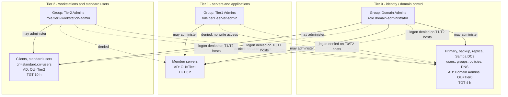

# Applying the AD tier model to UCS (without Samba)

Question: can the [Active Directory Tier Model](https://microsoft.github.io/ActiveDirectoryTierModel) be applied to a standard UCS domain without Samba/AD, using [delegative administration](https://docs.software-univention.de/ext-delegative-administration/5.2/en/index.html)?

**Answer: partly.** The *administration plane* (who may change which directory objects) and the *logon plane* (where tier admins may log on) can be separated with delegative administration plus UCR logon restrictions. This is implemented in the role [`configure_tier_model`](../roles/configure_tier_model/README.md). The remaining controls of the Microsoft model (authentication policy silos, GPO based hardening, PAWs, Kerberos protections) have no UCS equivalent and must be solved organizationally or with additional measures, see [What is missing](#what-is-missing).

> Delegative administration is an **experimental** feature of UCS 5.2-2+ ("Don't use it in production yet", "no stable update path", up to 2,000 objects). Everything below is an evaluation result, not a production recommendation.

The role was evaluated on UCS 5.2-7 (errata 606-685) with a primary node, a backup node and a replica node. Note that this test domain had Samba installed on the backup and replica node, see [Samba](#samba).

The linked Microsoft page is only an index of the deployment tooling, so the tier definitions used here are the generally known ones: Tier 0 = identity/domain control, Tier 1 = servers and applications, Tier 2 = workstations and standard users. The rule is that credentials of a tier are never used on a less privileged tier and a tier admin can not manage objects of a higher tier.

## Mapping to UCS

| Tier | UCS objects | Admin group | How it is enforced |
|---|---|---|---|
| 0 | Primary, backup and replica nodes (they hold a full LDAP copy including password hashes and Kerberos keys), users, groups, policies, DNS, shares, ... | `Domain Admins` | role `domain-administrator` |
| 1 | Member servers | `Tier1 Admins` | custom role `tier1-server-admin` |
| 2 | Clients, standard users | `Tier2 Admins` | custom role `tier2-workstation-admin`, users limited to the container `cn=standard,cn=users` |

Solid arrows show the administration plane (delegation, AD ACLs). Dotted arrows show what is denied, including the logon restrictions per host.

Two mechanisms are combined:

1. **Delegation (administration plane).** Roles are assigned to groups via `guardianMemberRoles`. A role only grants capabilities for UDM object types (and positions); everything not granted is invisible and read-only denied. Tier 1/2 roles explicitly deny `guardianRoles`, `guardianInheritedRoles` and `groups` so that a lower tier can not give itself or a computer higher privileges. The tier groups themselves are only changeable by Tier 0.
2. **Logon restrictions (logon plane).** On every host `auth/<service>/restrict=yes` and only the tier group of that host (plus `root` and the machine groups) is allowed for `login`, `sshd`, `other`, `rlogin`, `screen`, `ppp`. Tier 0 admins are therefore *not* allowed on Tier 1/2 hosts and vice versa.

## Setup steps (what the role automates)

1. Create `Tier1 Admins`, `Tier2 Admins` and the container `cn=standard,cn=users`.
2. On the primary and every backup node: `univention-configure-udm-authorization --store-local prune|create-permissions|create-default-roles`, then install `/etc/custom-udm-roles.policy` and run `... create-roles --config /etc/custom-udm-roles.policy`.
3. Assign the roles to the groups, e.g. `udm groups/group modify --dn "cn=Domain Admins,..." --append guardianMemberRoles="udm:default-roles:domain-administrator"` (before activation, or Tier 0 locks itself out).
4. UMC policies (`policies/umc`) for the tier groups, `directory/manager/rest/authorized-groups/<name>` for the groups.
5. `ucr set directory/manager/web/delegative-administration/enabled=true directory/manager/rest/delegative-administration/enabled=true`, restart `univention-management-console-server` and `univention-directory-manager-rest`.
6. UCR `auth/*` logon restrictions per host according to its tier.
7. Add the administrator accounts to the tier groups (not done by the role).

## Test results

REST API of the primary node, users in the tier groups plus a user without role:

| Check | Result |
|---|---|
| Tier 1 admin lists users, groups, DC objects, policies, clients | 0 objects visible (nothing granted) |
| Tier 1 admin lists member servers | visible, can modify them |
| Tier 1 admin: add a member server to `Domain Admins`, set `guardianRoles` | 403 |
| Tier 1 admin: modify DC object, `Domain Admins`, `Administrator`, client objects | 404 (not visible) |
| Tier 2 admin lists users | only the user in `cn=standard,cn=users` |
| Tier 2 admin modifies a client, adds it to `Domain Admins` | modify 204, group change 403 |
| Tier 2 admin: touch `Administrator` or a user outside the container | 404 |
| Tier 2 admin: set `guardianRoles`, groups or other attributes of a standard user | 403 |
| User without role | 403 "Not in allowed groups" |
| Tier 0 admin | full access |
| UMC modules (via UMC policy) | Tier 1 refused for users/groups modules, Tier 2 refused for groups module |
| SSH to Tier 0 hosts (pdn, bdn1) | only Tier 0 admin allowed |
| Replica switched to tier 1 / tier 2 | only the Tier 1 / Tier 2 admin allowed, Tier 0 admin denied; reverting to tier 0 restores it |

Not verified: object level actions inside the UMC web interface (only the module level was checked), and Tier 1/2 hosts that are real member servers/clients (a replica node was temporarily used to test the rules).

The role is idempotent (second run: no changes).

## Findings and limitations

- **Only primary and backup nodes.** Delegative administration is only supported there. `create-permissions` needs `/etc/ldap.secret`, which does not exist on replica nodes (it fails there). Replica and member nodes only get the logon restrictions; their administrators must use UMC/REST of a primary or backup node.
- **Only UMC and the UDM REST API are covered.** The UDM CLI, direct LDAP access, `root` on the directory nodes, and anyone who can read `/etc/ldap.secret`/machine secrets bypass delegation completely. "LDAP ACLs no longer govern the actor" also means delegation roles are the only barrier on UMC/REST.
- **Creating computer objects as Tier 1/2 is unsafe.** UDM writes a default `primaryGroup` on create, so the property can not be protected (`none` and `readonly` both break creation). A Tier 1/2 admin could create a computer with primary group `Domain Admins`, which makes it a member of that group (checked). Value based protection (`values.not-equals`) is documented in the default policy, but the required condition (`udm:conditions:target_property_value_compares`) is not installed on UCS 5.2-7 (`/usr/share/univention-directory-manager-modules/conditions/` is missing) and breaks all UDM calls of the role. The default role `linux-ou-client-manager` has the same issue ("FIXME: can put the client into Domain Administrators"). Therefore the role only allows *modify/remove* for Tier 1/2 (`configure_tier_model_allow_computer_create: false`) and `primaryGroup` is read-only. Computers have to be created/joined by Tier 0 or with a join account.
- **Password reset by Tier 2 does not work reliably in this version.** A PATCH of `password` or `unlock` on a standard user returns 500 (`The object was modified by another request`, `KeyError: 'disabled'` in `users/user.py::_ldap_pre_ready`). The stock `helpdesk-operator` role fails identically, so it is a limitation of the experimental feature and not of the role. The Tier 2 user permissions are included for when this is fixed.
- **`create-roles` does not remove stale capabilities.** After a policy change old capabilities remain and can break UDM (we saw HTTP 500 for a removed condition). The role therefore runs `prune` + `create-permissions` + `create-default-roles` + `create-roles` whenever the policy changes. `create-roles --remove` did not remove anything. The local store is per node, it has to be rebuilt on every primary/backup node.
- **Tier 0 admins can not log on to Tier 1/2 hosts** (by design). They manage them through UMC/REST. `root` stays allowed as break glass, so root credentials/SSH keys of member servers become Tier 0 secrets and must not be shared with Tier 1/2.
- **The file `/etc/custom-udm-roles.policy`** is created per node; the documented config path for `create-roles` is inconsistent in the Univention docs (`custom-udm-roles.policy` vs. `udm-roles.policy`), the role passes the explicit path.

## What is missing

Not possible with UCS (without Samba) or not covered by the role:

- **Authentication policy silos / Protected Users / Kerberos armoring** (Microsoft: block a Tier 0 account from authenticating on other tiers at the KDC). UCS only restricts the *local PAM account check*. A Tier 0 password sent to a Tier 1 host (e.g. a wrong login attempt, sudo, web applications) is still exposed. Mitigation: dedicated admin accounts per tier, no password reuse, SSH keys, 2FA/Keycloak for the UMC.
- **GPO/host hardening per tier** (user rights assignment, deny logon via GPO). On UCS use configuration management (other roles in this collection, e.g. `hardening`) per tier.
- **Applications**: Tier restrictions only cover SSH/console/PAM services configured through `auth/*`. Web UIs, Nextcloud, mail, shares etc. need their own group restrictions.
- **Privileged Access Workstations and network segmentation** (firewall rules between tiers) are out of scope.
- **Auditing and detection** of tier violations (the Microsoft model ships Sentinel monitoring). Use the UDM REST log (`/var/log/univention/directory-manager-rest.log`, shows `requester_dn`) and PAM logs.
- **Tier of replica nodes**: they hold all password hashes, so they are Tier 0 in this role, even though they are "servers".
- **Decide who gets `Domain Admins`.** Only Tier 0 admins (and the `Administrator` account) may be members; delegation of Tier 0 itself is not possible.

## Samba/AD

With Samba/AD (`univention-samba4`) the tier model has to be applied in AD as well. AD administration with `samba-tool`, RSAT or Windows tools talks to Samba directly and does **not** go through UDM, so delegative administration does not restrict it. The role therefore adds an AD part (`tasks/samba.yml`), which runs when a Samba AD DC is part of the play. The domain must be at a functional level that supports authentication silos (2012 R2+; the test domain was at 2016, see the role `configure_samba_functional_level`).

What the role does in AD:

1. **OUs.** `Tier0` (`Admins`, `Groups`), `Tier1` (`Admins`, `Servers`, `Groups`), `Tier2` (`Admins`, `Workstations`, `Users`) are created in UDM on the primary node. The S4 connector replicates them to AD. Tier 0 keeps using the built-in objects (`OU=Domain Controllers`, `CN=Users`); existing objects are not moved.
2. **ACLs** (`samba-tool dsacl set` on the tier OU, inherited by its sub OUs), on the Samba DC with the PDC emulator role:
   - Tier 1 admins: create/delete computer objects and full control on computer objects in `OU=Tier1`.
   - Tier 2 admins: the same for `OU=Tier2`, plus reset password, `pwdLastSet` and `lockoutTime` on user objects in `OU=Tier2` (no right to create users).
   - Tier 0 relies on the built-in `Domain Admins` ACEs. The ACEs are only added if the tier group has no ACE on the OU yet; to change them later, remove the OUs (UDM `container/ou remove --recursive`) and re-run.
3. **Authentication policies and silos** `Tier0/1/2-Policy` and `-Silo` with an enforced TGT lifetime for users (4 h, 8 h, 10 h). The *current* members of the tier groups are granted and assigned to their silo (a user in several tier groups gets the most privileged tier). New admins are picked up on the next run.

Test results (`samba-tool`/`ldbmodify` against `bdn1`, as the tier users, over LDAP):

| Check | Result |
|---|---|
| Tier 1 admin creates a computer in `OU=Tier1,OU=Servers`, modifies it | OK |
| Tier 1 admin: computer in `OU=Tier2` or the default `CN=Computers` | insufficient access |
| Tier 2 admin creates a computer in `OU=Tier2,OU=Workstations` | OK |
| Tier 2 admin resets the password of a user in `OU=Tier2,OU=Users` | OK |
| Tier 2 admin: create a user in the Tier 2 OU | insufficient access |
| Tier 1/2 admin: reset passwords of `Administrator`, `t0admin` or other users outside their OU | refused |
| Tier 1/2 admin: add themselves to `Domain Admins`, modify a DC computer object | refused |
| `kinit` TGT lifetime for tier 0 / 1 / 2 admin | 4 h / 8 h / 10 h |
| UMC login of silo members | works |

The same tests without the ACEs (before the role) were also refused, because AD gives ordinary users no write rights; the ACEs are what *enable* tier delegation in AD. Computer objects created in UDM (e.g. `computers/memberserver`) are placed in `cn=memberserver,cn=computers` and are therefore not below `OU=Tier1`: to have the AD ACLs apply, create them with position `ou=Servers,ou=Tier1,<ldap base>`.

### ren1 as Tier 1 Samba DC

The host tier is set per host (`configure_tier_model_host_tier`). Following the requested layout `bdn1` is Tier 0 (`auto`) and `ren1` is set to `1` in the inventory. Then only `Tier1 Admins` (plus root and machine accounts) may log on to `ren1`; `Domain Admins` may not. Tested: on `ren1` only the Tier 1 admin is allowed, on `pdn`/`bdn1` only the Tier 0 admin.

**This is weaker than it looks.** `ren1` is a writable Samba DC with a full copy of the AD database (all password hashes, the `krbtgt` key). The computer object stays in `OU=Domain Controllers` and Tier 1 admins have no AD rights on it, but anyone who gets root on `ren1` (or its machine secret) can read the whole domain and thereby takes over Tier 0. The Microsoft model treats every writable DC as Tier 0. If `ren1` must be Tier 1, give Tier 1 admins no sudo/root on it, and consider a read-only DC (RODC) instead, which does not store the secrets of privileged accounts.

### AD limits and recommendations

- **No device based logon restrictions.** Silos with `--user-allowed-to-authenticate-from` (Tier 0 users may only authenticate from Tier 0 devices) need Kerberos armoring (FAST) from the client. Windows clients do that; the PAM Kerberos login of UCS hosts does not, so enforcing it would lock admins out of UCS hosts. The role only enforces the TGT lifetime. Test conditions in audit mode first (`--audit`).
- **Protected Users** (no NTLM/RC4, 4 h TGT) is not applied. The group is managed in UDM (`cn=Protected Users,cn=users`), and adding `Administrator` or join accounts can break joins and share access. Add dedicated Tier 0 admin accounts to it.
- **Machine account quota** (`ms-DS-MachineAccountQuota`, default 10) was not changed; creating computers by ordinary users was refused anyway in the test. Set it to 0 as a hardening step.
- **Group Policy** based hardening (deny logon locally/over network per tier) is not set up. It needs Windows clients.
- **UDM and AD are two permission systems.** UDM delegation does not limit AD tools, and AD ACEs do not limit UDM; both are configured consistently by the role, but a change of one is not reflected in the other. UDM changes reach AD through the S4 connector, which uses its own privileged account.
